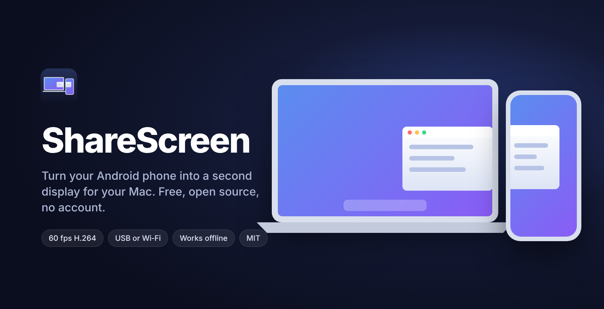

<p align="center">
  
</p>

# ShareScreen

<p>
  <a href="../../releases/latest"></a>
  <a href="../../actions/workflows/ci.yml"></a>
  <a href="../../releases"></a>
  
  <a href="LICENSE"></a>
</p>

Use your **Android phone as an extra display for your Mac, Windows PC or Linux computer**. Drag windows onto it like a real monitor.

- **60 fps hardware H.264** streaming with very low delay
- **USB or Wi‑Fi**, including your phone's own hotspot with no internet
- **No accounts, no cloud.** Everything stays on your local network
- **Finds your computer automatically**, so you never type an IP address
- Portrait or landscape, with adjustable size and quality
- Free and open source ([MIT](LICENSE))

> Display only: touch on the phone doesn't control the computer.

---

## Download

Grab the latest files from **[Releases](../../releases/latest)**:

| File | For |
|---|---|
| `ShareScreen.dmg` | Mac (macOS 13 Ventura or newer, Apple Silicon or Intel) |
| `ShareScreen.apk` | Android 7.0 or newer |
| `ShareScreen-Setup.exe` | Windows 10 (1903+) / 11, 64-bit: installer |
| `ShareScreen-Portable.exe` | Windows: single file, no install |
| `ShareScreen.deb` | Ubuntu / Debian (X11 or Wayland) |

---

## Install

Install ShareScreen on **your computer** (pick your OS), then on **your phone**.

### 1a. Mac

1. Open `ShareScreen.dmg` and drag **ShareScreen** into **Applications**.
2. The app isn't notarized by Apple, so macOS shows *"ShareScreen.app" Not Opened* the first time. Click **Done** (not Move to Trash), then either go to System Settings → **Privacy & Security** → **Open Anyway**, or run:
   ```bash
   xattr -dr com.apple.quarantine /Applications/ShareScreen.app
   open /Applications/ShareScreen.app
   ```
3. Allow **Screen Recording** when asked: System Settings → Privacy & Security → Screen Recording → turn on **ShareScreen**. Then quit ShareScreen and reopen it.
4. Allow **Local Network** access if macOS asks.

A new icon appears in your menu bar.

### 1b. Ubuntu / Debian

```bash
sudo apt install ./ShareScreen.deb
```

Open **ShareScreen** from your apps. A tray icon appears; the phone connects on its own.

- **Xorg session:** ShareScreen adds an extra monitor to the right of your screen and removes it when you quit.
- **Wayland session** (Ubuntu's default): your desktop asks once which screen to share. On GNOME 46+ (Ubuntu 24.04) and KDE Plasma 6 you can choose a **new virtual monitor**, so the phone becomes an extra screen; on older desktops you pick a screen to mirror.
- If you don't see the tray icon on GNOME, install the AppIndicator extension (`sudo apt install gnome-shell-extension-appindicator`, then log out and in).

From a terminal you can also run `sharescreen --portrait`, `--mirror`, `--quality sharp`, `--sound`, `--multi` or `--no-tray`; see `sharescreen --help`.

### 1c. Windows

1. Run `ShareScreen-Setup.exe`. If SmartScreen warns, click **More info → Run anyway**. The installer adds a Start-menu shortcut, the Windows Firewall rule, and (optionally) starts ShareScreen when you sign in. Prefer no install? Use `ShareScreen-Portable.exe` and allow it on **private networks** when the firewall asks.
2. A tray icon appears (click **^** next to the clock if it's hidden). The phone connects on its own.
3. With one monitor, the phone **mirrors** your screen. To use it as an **extra** screen, install the free [Virtual Display Driver](https://github.com/VirtualDrivers/Virtual-Display-Driver), set its resolution to your phone's (e.g. 2400×1080), and restart ShareScreen. It picks the extra monitor automatically; you can change it under **Monitor** in the tray menu.

ShareScreen uses your graphics card (NVIDIA, Intel or AMD) for encoding when it can, and falls back to the CPU. The app bundles an unmodified [FFmpeg](https://ffmpeg.org) under GPL v3; see [THIRD_PARTY_NOTICES.txt](THIRD_PARTY_NOTICES.txt). Its source is attached to every release as `ffmpeg-source.tar.gz`.

### 2. Android

1. Copy `ShareScreen.apk` to your phone and open it. Allow "Install unknown apps" when asked.
2. Open **ShareScreen**. It finds your computer and the extra display turns on by itself.

Both devices must be on the same Wi‑Fi, or the computer connected to the phone's hotspot.

---

## USB mode (lowest delay)

USB is the smoothest option. It needs `adb` and USB debugging on the phone.

**Enable USB debugging on the phone**
1. Settings → About phone → tap **Build number** (on Xiaomi/Redmi: **OS version**) 7 times.
2. Settings → Developer options (on Xiaomi: Additional settings → Developer options) → turn on **USB debugging**.
3. Plug the phone in and tap **Allow** on the "Allow USB debugging?" prompt.

**Install adb on the computer.** On Ubuntu: `sudo apt install adb`. On Windows: download [Platform Tools](https://developer.android.com/tools/releases/platform-tools). On a Mac, pick one:
```bash
# With Homebrew
brew install android-platform-tools

# Without Homebrew
cd ~ && curl -L -o pt.zip https://dl.google.com/android/repository/platform-tools-latest-darwin.zip \
  && unzip -q -o pt.zip && rm pt.zip
echo 'export PATH="$HOME/platform-tools:$PATH"' >> ~/.zshrc && source ~/.zshrc
```

**Connect over USB.** Run this each time you plug the phone in:
```bash
adb devices   # your phone should be listed as "device"
adb reverse tcp:8780 tcp:8780 && adb reverse tcp:8781 tcp:8781 && adb reverse tcp:8783 tcp:8783
```
Then open ShareScreen on the phone. It uses USB automatically when it's available.

---

## Using it

**Windows and Linux:** use the ShareScreen tray icon:

| Menu | What it does |
|---|---|
| **Extra display on** | Turns streaming on or off. |
| **Play sound on phone** | Plays the computer's sound on the phone (it keeps playing on the computer too). |
| **Stream quality** | **Fast** for Wi‑Fi, **Balanced**, **Sharp** for USB. |
| **Monitor** (Windows) | Which monitor the phone shows. |
| **Show QR code…** | Opens the screen in any phone browser, with no app needed. |
| **Start at login** | Starts ShareScreen when you sign in. |

On Windows, arrange the extra monitor in **Settings → System → Display**; on Ubuntu, in **Settings → Displays**.

**Several phones:** run `sharescreen --multi` (Linux) or install more virtual monitors with the Virtual Display Driver (Windows); each phone that connects gets its own monitor.

**On the phone:** tap the screen to show live stats (resolution, frame rate, bitrate, decode time, dropped frames). Tap again to hide them.

**Mac:** click the ShareScreen icon in the menu bar:

| Menu | What it does |
|---|---|
| **Turn On / Off Extra Display** | Starts the display manually. By default it turns on when the phone connects and off about 20 s after it leaves. |
| **Show QR Code…** | Opens the screen in any phone browser, with no app needed (simpler, lower frame rate). |
| **Display Size** | Phone‑shaped (landscape or portrait) or 16:9. **Sharp text (HiDPI)** makes text crisper but uses more bandwidth. |
| **Stream Quality** | **Fast** for Wi‑Fi, **Sharp** for USB. |
| **Play Sound on Phone** | Plays the Mac's sound on the phone too. |

Arrange the new display next to your Mac's screen in **System Settings → Displays → Arrange…**

---

## Troubleshooting

<details>
<summary><b>Phone says "Looking for your computer…"</b></summary>

- Make sure ShareScreen is running (on a Mac, its icon is in the menu bar) and both devices are on the same network.
- On Windows, allow ShareScreen through Windows Firewall on **private networks**. On Ubuntu with a firewall, allow ports 8780, 8782 (UDP) and 8783.
- On a Mac, check that **Local Network** is allowed: System Settings → Privacy & Security → Local Network.
- On the phone, tap **Enter address** and type the IP shown in the ShareScreen menu (Mac) or terminal window (Windows, Linux).
- Over USB, run the `adb reverse` command again.
</details>

<details>
<summary><b>"Screen Recording permission needed" even though it's turned on</b></summary>

macOS sometimes keeps a permission from an older copy of the app. To fix it:
1. System Settings → Privacy & Security → Screen Recording
2. Select **ShareScreen** and click **−**
3. Click **+**, add **ShareScreen** from Applications, and turn it on
4. Quit ShareScreen and reopen it

Or reset it from Terminal:
```bash
tccutil reset ScreenCapture np.com.saagarshrest.macscreen
```
</details>

<details>
<summary><b>Laggy or choppy</b></summary>

- Use **USB mode**, or your phone's **5 GHz hotspot** instead of a busy router.
- Stream Quality → **Fast**, and turn off **Sharp text (HiDPI)**.
</details>

<details>
<summary><b>adb: "no devices/emulators found"</b></summary>

- Turn on USB debugging (see above), set the USB mode to **File transfer**, replug, and tap **Allow** on the phone.
- Try another cable. Some cables only charge and don't carry data.
</details>

---

## Build from source

**Mac app.** Needs the Xcode Command Line Tools:
```bash
xcode-select --install                 # once
sudo xcodebuild -license accept         # once, if you have full Xcode
git clone https://github.com/saagarshrest/screenshare.git
cd screenshare/mac
bash ./build.sh        # builds ShareScreen.app
bash ./build.sh dmg    # also builds ShareScreen.dmg
open ShareScreen.app
```
The first build creates a local signing certificate in your keychain, so macOS keeps the Screen Recording permission across rebuilds. It may ask for your password once.

**Android app.** Needs JDK 17 and the Android SDK, or just Android Studio:
```bash
cd screenshare/android
./gradlew assembleRelease
adb install -r app/build/outputs/apk/release/app-release.apk
```

**Releases.** Pushing a tag builds both installers on GitHub Actions and attaches them to a release:
```bash
git tag v1.0.0 && git push origin v1.0.0
```

---

## How it works

```
Mac (menu bar app)                                         Android
virtual display ─▶ ScreenCaptureKit ─▶ VideoToolbox H.264 ─tcp:8783─▶ MediaCodec ─▶ SurfaceView
UDP beacon :8782 ──────────────────────────────────────────────────▶ auto‑discovery
HTTP :8780 / WebSocket :8781 (JPEG) ───────────────────────────────▶ any browser (QR code)

Windows / Linux (host/sharescreen.py)
monitor ─▶ ffmpeg (ddagrab / x11grab) ─▶ x264 or GPU H.264 ────tcp:8783─▶ same Android app
```

- On the Mac, the extra monitor is created with Apple's private `CGVirtualDisplay` API, the same one used by BetterDisplay and DeskPad. A future macOS update could break it.
- Frames are only sent when the screen changes, so a still screen uses almost no data.
- If the network falls behind, the computer skips ahead to a fresh keyframe instead of building up lag.

| Port | Use |
|---|---|
| 8780 | Viewer page and `/ping` |
| 8781 | WebSocket JPEG stream (browser) |
| 8782 | UDP discovery |
| 8783 | H.264 stream (Android app) |

---

## Roadmap

- [x] Windows host (`.exe`)
- [x] Linux host (`.deb` for Ubuntu, X11)

## License

[MIT](LICENSE) © 2026 Saagar Shrestha
